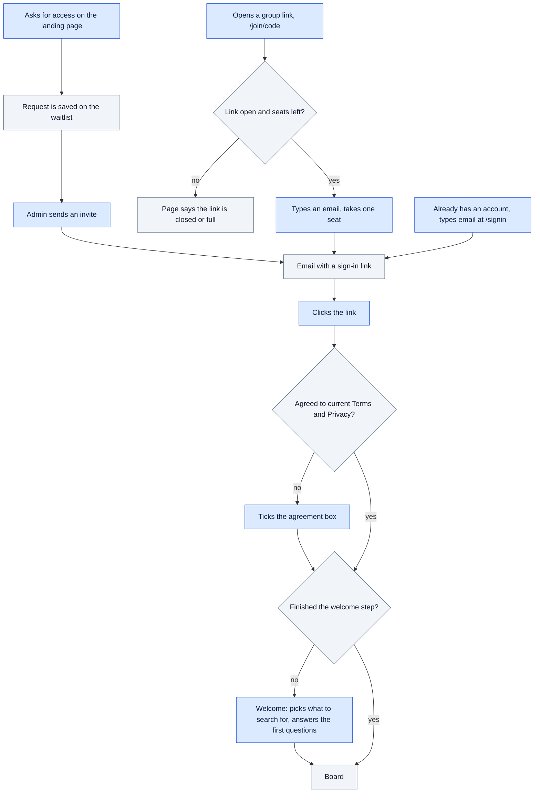
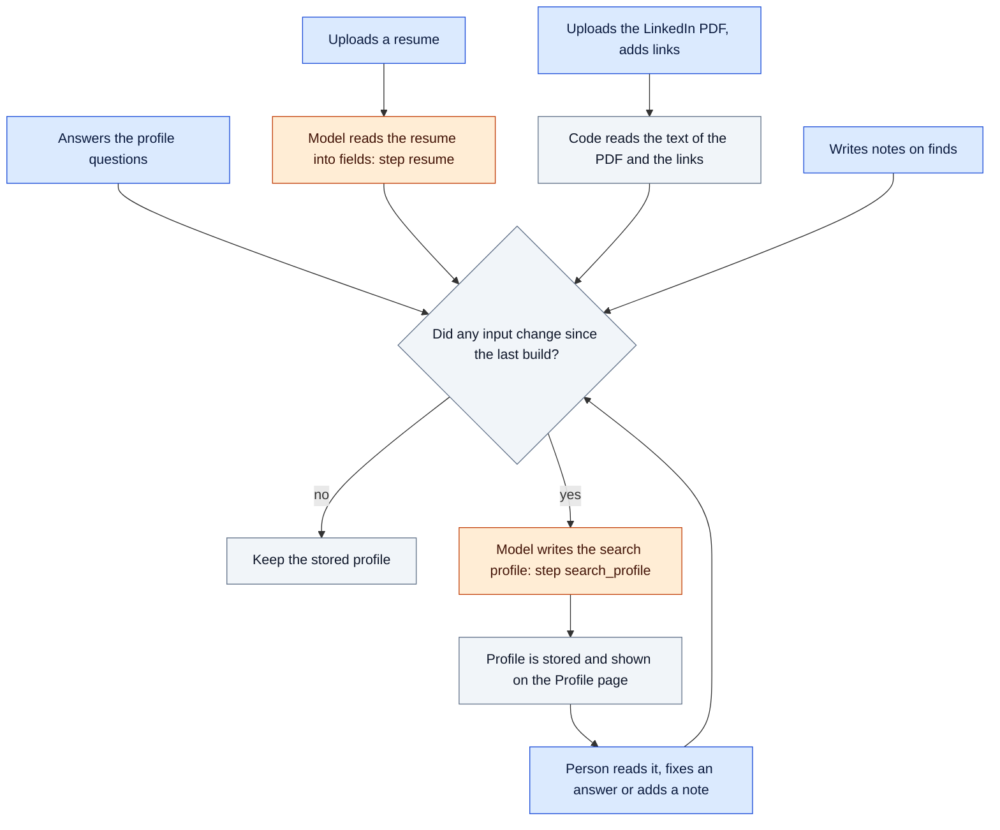
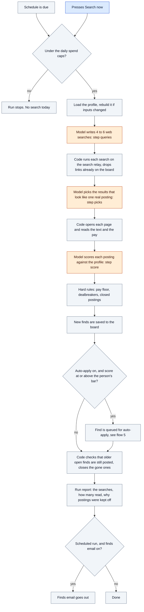
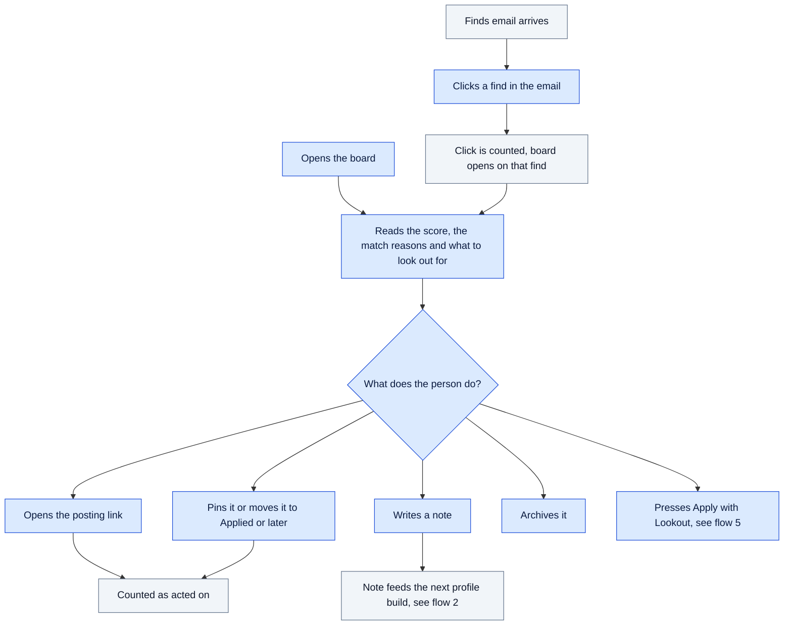
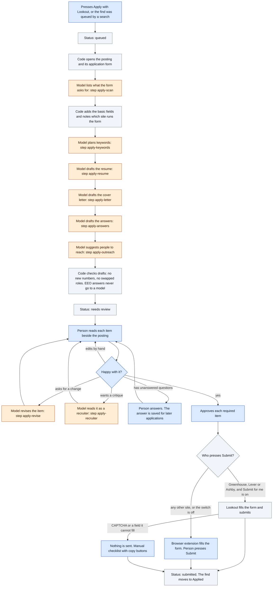

# How Lookout works: the flows

Every main flow as a diagram, for someone who has not read the code. For where the code lives, see [architecture.md](architecture.md).

Each box has one of three colors:

- **Blue: a person does it.** The app waits here.
- **Orange: an AI model does it.** Each of these is one request to the model, and each has a step name. The same names show in the AI request log (#985).
- **Grey: plain code does it.** No model, no person.

## 1. Getting in

Three doors lead to the same sign-in link. Lookout has no passwords.

## 2. The search profile

Lookout does not search with the raw resume. It builds one short picture of the person and searches with that. The person can read it on Profile, under "What Lookout sees".

Notes are the feedback loop. Most notes are private jottings. The model keeps only the ones that say something about what Lookout found, for example "too junior" or "I do not want agencies".

## 3. One search run

A run starts on the person's schedule (the scheduler checks every 10 minutes) or when the person presses Search now. Searches run one at a time.

Where it searches: the open web, through a self-hosted search relay (SearXNG). Some queries aim at employer pages on Greenhouse, Lever, Workday and Ashby. Listing pages from Indeed, LinkedIn, Glassdoor and ZipRecruiter are skipped, because they are lists, not postings.

## 4. Working the board

Nothing here uses a model. This flow is the one the main metric counts: people who act on a find each week.

## 5. Auto-apply (beta, admins only on production)

The rule that holds this flow together: nothing is sent until the person approves the exact version of every required item.

On production today: auto-apply is on for admins only, and Submit for me is off. So every application ends with the person pressing Submit.

## Every AI step

These are all the places a model is asked something. Everything else is code.

| Step name | Flow | What the model is asked | What checks its answer |
| --- | --- | --- | --- |
| `resume` | Profile | Read an uploaded resume into fields | The person sees and edits the fields |
| `search_profile` | Profile | Write the short picture of the person | Shown on Profile, the person corrects it |
| `queries` | Search | Write 4 to 6 web searches | If none come back, the target titles are searched |
| `picks` | Search | Pick results that look like one real posting | Code reads each page and drops lists and closed postings |
| `score` | Search | Score each posting against the profile | Hard rules for pay floor and dealbreakers |
| `apply-scan` | Auto-apply | List what the application form asks for | Code adds basic fields, the person reviews |
| `apply-keywords` | Auto-apply | Plan which posting keywords the resume can truthfully carry | The person sees the keyword pills on the review page |
| `apply-resume` | Auto-apply | Draft the resume for this posting | Code flags new numbers and swapped roles |
| `apply-letter` | Auto-apply | Draft the cover letter | Same checks, then the person |
| `apply-answers` | Auto-apply | Draft answers to the form's questions | Unknowns become questions for the person |
| `apply-outreach` | Auto-apply | Suggest people to contact and a message | Drafts only. Lookout never sends them |
| `apply-revise` | Auto-apply | Change one item as the person asked | Saved as a new version with a note |
| `apply-recruiter` | Auto-apply | Critique an item as a recruiter | Shown as advice, changes nothing |
| `master-resume` | Auto-apply | Build one master resume from the person's materials | Date and role checks |
| `events`, `score_rfps` | Switched off | Networking events and RFP searches | Off on production |

## Where the app waits for a person

1. The sign-in link in the email.
2. The agreement box, when Terms or Privacy changed.
3. The welcome step.
4. Search frequency and the finds email, in Settings. Nothing prompts for these; the defaults apply until the person changes them.
5. Review and approval of every auto-apply item.
6. Unanswered application questions.
7. The final Submit, on every site where Lookout does not submit by itself.

## What can stop a run

- A spend cap: per person per day, or for everyone per day.
- The search relay returns nothing, when the search engines block it.
- No AI model is set in Admin.
- The model returns an answer that is not valid. Code asks again, up to 3 times, then fails the step.
